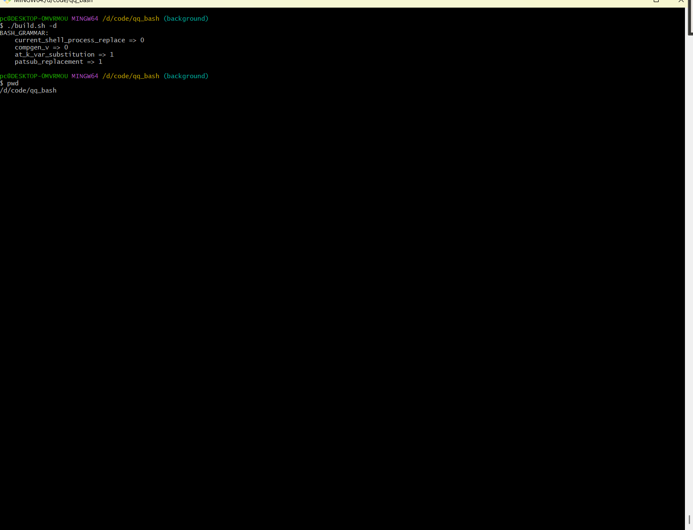

# qq_bash

**A pure-Bash toolkit — and an `xo` object-system validation game built with it.**

`qq_bash` bundles a small standard-library of string/array helpers, a JSON-like
tree (`x`), an object system (`xo`), and **strafe_bash**: a playable ASCII
shooter that runs entirely in Bash. No Node, Python, or game engine.

```bash
chmod +x ./src/strafe_bash/strafe_bash.sh
./src/strafe_bash/strafe_bash.sh              # play
./src/strafe_bash/strafe_bash.sh -t light     # light-background terminal
./src/strafe_bash/strafe_bash.sh -h           # controls, options, author
```

All library and test sources are tracked `.sh` files; there is no build step.

Requires Bash 5+, a UTF-8 locale, and a 256-color terminal.

> The Bash version is **feature-frozen**: bug fixes, balance tuning, and cleanup
> only — no new Bosses, weapons, or mechanics. Architecture, the `xo` object
> system, the `x` tree, and the test flow are documented in
> [DEVELOP.md](DEVELOP.md). Project conventions: [CONSTITUTION.md](CONSTITUTION.md).

## What's inside

| Module | What it does |
|---|---|
| **`xo`** | Class templates, single inheritance, mixins, object pool, named objects, method dispatch |
| **`x`** | In-memory JSON-like tree: objects, arrays, null/bool, paths, DFS, JSON round-trip |
| **`strafe_bash`** | Terminal shooter: planes, enemies, three Bosses, weapons, drops, save/load |
| **`str` / `array` / `float` / `var`** | UTF-8-aware strings, arrays, numbers, indirection helpers |

## strafe_bash



A small but complete terminal shooter. Auto-fire is always on; the fun is in
positioning, weapon timing, and surviving the Bosses.

- **5 weapon tiers** — tier 1 is the default `.` shot; tiers 2–5 are the
  Quantum Energy Weapon `|`, star `#`, at `@` and dollar `$`; each tier's actual
  class is randomized per run from its own library.
- **4 selectable planes** — balanced Bee, armored Hornet, fast Eagle-1, and the
  heavy Il-2; each has its own HP, score multiplier, bullet speed, and shield art.
- **Three Bosses** — the classic `Boss` (HP 180), the spinning `BossSpinner`
  (HP 300), and the compact `SkullKing` (HP 600). SkullKing has four damage
  phases and fires 8-direction `X`/`O` rings: five rings per burst, then a
  2.7-second rest. Its spawn chance is about two-thirds that of each other
  Boss. At most one Boss on screen.
- **Boss invulnerability windows** — after each damage-phase transition, a Boss
  is invulnerable for 3 seconds and is tinted cyan.
- **Boss abilities** — every phase transition also grants a Boss a temporary
  ability: invulnerability, self-heal, homing missiles, a scanning red wave, or
  a player slow. The active one is shown as a short label on the Boss HP row.
- **Readable fire** — non-laser player bullets use a muted slate-blue palette
  tone while lasers shift colour with their power level; enemy bullets use warm
  or bright accent colors, so the two never blend.
- **Drops and words** — `H` heal, `b` bomb, `m` missile, `L` lane, `S` shield,
  `W` net (summons a green scanning wave that sweeps upward, clears enemy
  bullets and missiles on its row and damages enemies); touching a falling word
  collects it for score. `m` now launches a missile
  that automatically homes in on the nearest enemy. At five bombs, picking up
  another `b` immediately detonates the pickup without spending stock.
- **Hit sparks** — short-lived `*` marks show bullet impacts, shield absorbs,
  and player damage without spawning extra objects.
- **Blink after damage** — the player blinks through a short invulnerability
  window after taking a hit. The Il-2 blinks for 4 seconds, other planes 3.
- **Il-2 ramming** — while blinking, flying into an enemy deals 5 damage to it,
  on a short cooldown.
- **Clear banner** — clearing the field after at least 30 seconds without an
  enemy escaping off the bottom shows `YOU ARE AN ACE FIGHTER PILOT!  +1000`;
  the ace banner has a 60-second cooldown and cannot stack while one is
  showing. Killing a Boss shows `<BOSS NAME> WAS KILLED BY YOU!  +2000`.
  Either condition triggers the short FIGlet-style `EXCELLENT!` overlay.
  These bonuses are fixed and are not reduced by the Hornet score multiplier.
- **Minimal save** — score, HP, pickups, active weapon slot, the run's weapon
  classes, the chosen plane, and cleared Boss count/stage. Loading starts a fresh wave.
- **30 Hz logic / 30 Hz render** — fixed tick loop, raw terminal input, ANSI
  256-color output, no external runtime.

### Choose your plane

| # | Plane | HP | Trait |
|---|---|---|---|
| 1 | Bee | 20 | Balanced; no penalty |
| 2 | Hornet | 30 | Armored; kills and words give 60% score |
| 3 | Eagle-1 | 15 | Non-quantum bullets +1 speed; fire interval -1 tick; Quantum Energy Weapon unaffected |
| 4 | Il-2 Sturmovik | 40 | Heavy armor; all bullets -1 speed |

Shield size follows the plane: a wider plane has a wider shield and clears
enemy bullets over a larger area. Damage without a shield is always the center
of the first row.

**Il-2 ramming build**: take one hit to enter the 4-second angry state, then fly
into enemies. The invulnerability window matches the blink duration.

### Controls

| Key | Action |
|---|---|
| `1`–`4` | Choose a plane on the title screen |
| `W A S D` / `H J K L` | Move |
| `Y U` / `B N` | Move diagonally (up-left/up-right, down-left/down-right) |
| — | Fire automatically |
| `SPACE` / right click | Use a bomb (after picking up `b`) |
| `P` | Pause / resume |
| `Q` | Quit |
| `S` | Save while paused (hidden `.strafe_save`) |
| `L` | Load while paused, or from the title screen |

### Mouse support

Moving the mouse over the terminal moves the plane; right-click uses a bomb;
firing stays automatic. The pointer sits two cells below the plane so it does
not cover it.

- Mouse capture is always on while playing, so terminal text selection is
  unavailable until the game exits.
- The mouse only works while the terminal window has focus and the pointer is
  inside it.
- Without mouse support the plane is keyboard-only and every control still
  works.

### Terminal notes

- Theme: `./strafe_bash.sh -t light` (or `--theme dark|auto`). The default
  `auto` follows `COLORFGBG` and otherwise assumes a dark terminal. `-h` prints
  the full help: options, controls, drops, weapons and author.
- Registration validation: `./strafe_bash.sh -d` (or `STRAFE_DEBUG=1`). It runs
  the `compgen` reverse check for classes, templates, classes' methods and
  Mixins; normal startup uses the fast manual-registry path.
- Tested on mintty (MSYS2 / Git Bash). A plain Windows console window cannot
  report the mouse at all, so the plane is keyboard-only there.
- WindTerm may report clicks but not continuous movement; click-to-move still
  works there.
- The game runs on the alternate screen and restores your previous terminal
  content when it exits.
- Runtime errors go to `$STRAFE_ERRLOG` (default `/tmp/strafe_bash.err`); on
  exit the last lines are printed on the normal screen, so a crash is readable
  after the alternate screen is gone.
- Input polling: `read -t` is quantised to the 15.9 ms Windows timer on
  MSYS/CYGWIN, so a 2 ms timeout really waits 16 ms and costs frames. Those
  platforms therefore default to a probe-based loop (`read -t 0` + poll until the
  next tick); Linux keeps the exact 2 ms timeout. Set `STRAFE_INPUT_POLL=1` or
  `STRAFE_INPUT_POLL=0` to override the default.

Protocols, synchronized output and the alternate-screen rationale are in
[DEVELOP.md](DEVELOP.md#terminal-and-input-notes).

### Screenshot

<details>
<summary>Pure-text gameplay (80×24)</summary>

```text
┌─────────────────────────────────────────────────────────────────────────────────┐
│HP:3/20  SCORE:58440  W:@  BOMB:2/5  E:9/25  OBJ:116                             │
│BULLET |:1 #:2 @:3 $:4  DROP H:+3 b:BOMB m:MISSILE L:LANE S:SHIELD W:NET         │
│BONUS  |:  0  #:  0  @: 35  $:  0  m:  9  L:  0(1)  S:  0                        │
│                                  ___                      _____                 │
│                                 | M |                    /     \                │
│                                 |___|                   /  O O  \               │
│                                 [10/10]                 \_|_|_|_/               │
│                                                          \_____/                │
│                                                       [124/150]                 │
│                                                                                 │
│                                                        ! 0 !                    │
│                                                                                 │
│                                                       ! 0 !                     │
│                                                                                 │
│                                   +                                             │
│                                   +            o|o         ! 0 !                │
│                                                -'-                              │
│                                                                                 │
│                                                                                 │
│                                   +            ! 0 !                            │
│                       All you need is love.    ! 0 !                            │
│   .                                                                             │
│                                  +                                              │
│                                                   ___                    ___    │
│                                                  | B |                  | B |   │
│                                        ! 0 !     |___|                  |___|   │
│                                                  [4/30]                         │
│                                                    +                            │
│          Q                                                                      │
│         [_]                                                                     │
│   .                                              ! 0 ! ! !                      │
│                                                                                 │
└─────────────────────────────────────────────────────────────────────────────────┘
```

</details>

## Links

- Project: <https://github.com/qindapao/qq_bash>
- Author: **qindapao**
- GitHub: <https://github.com/qindapao>
- Blog: <https://qindapao.com>
- Email: <northisland2017@gmail.com>
