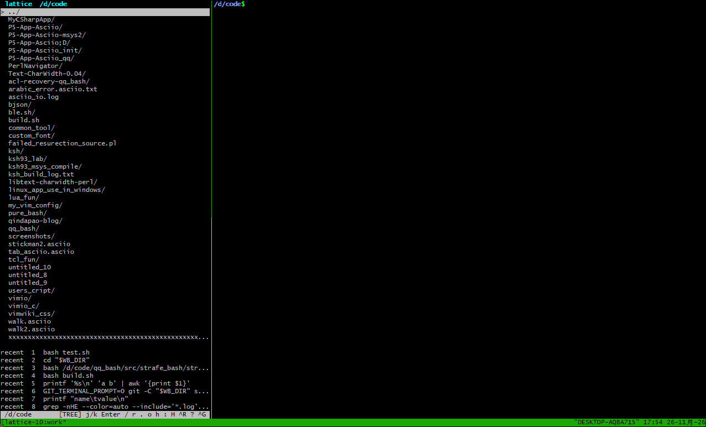
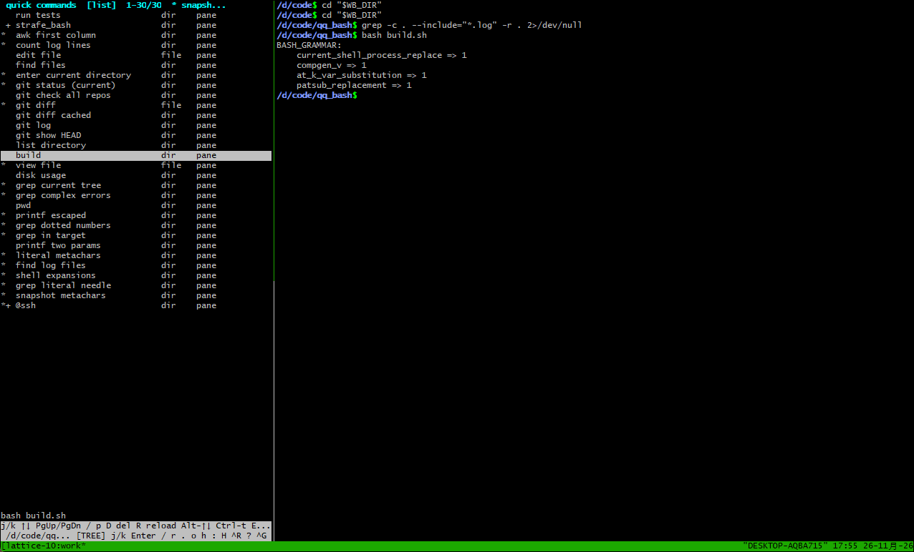
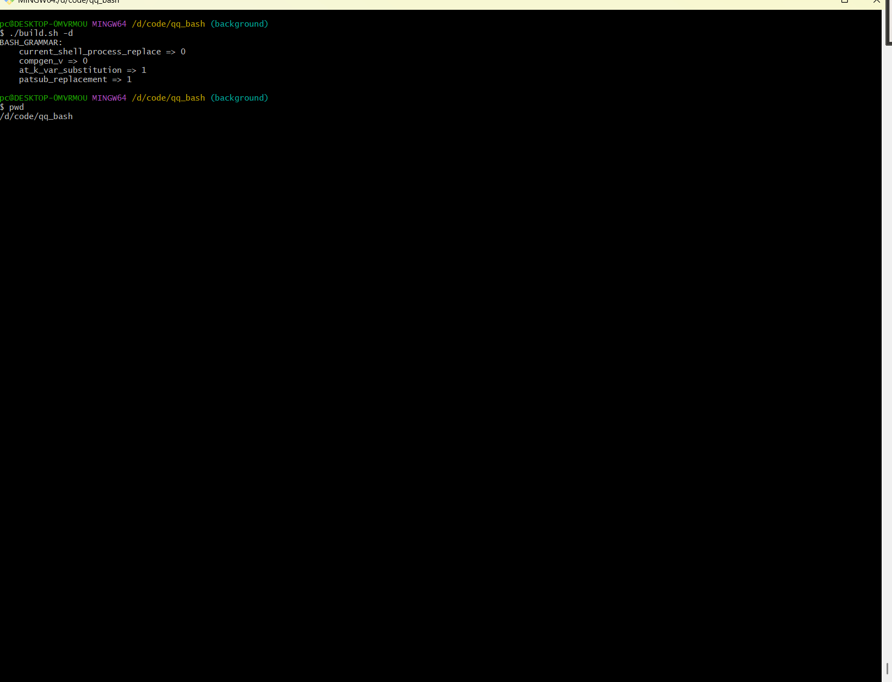

[English](README.md) | 简体中文

# qq_bash

**一个纯 Bash 的工具集 —— 以及用它构建的 `xo` 对象系统验证游戏。**

`qq_bash` 打包了一小套字符串/数组辅助函数标准库、一棵类 JSON 的树
（`x`）、一个对象系统（`xo`）、**strafe_bash**：一个可玩的 ASCII 射击游戏，
以及 **lattice_bash**：一个纯 Bash 的 tmux TUI 工作台。不需要 Node、Python 或
游戏引擎。

```bash
chmod +x ./src/strafe_bash/strafe_bash.sh
./src/strafe_bash/strafe_bash.sh              # play
./src/strafe_bash/strafe_bash.sh -t light     # light-background terminal
./src/strafe_bash/strafe_bash.sh -h           # controls, options, author
```

Lattice 工作台（需要 `tmux`）：

```bash
./src/lattice_bash/lattice.sh --root .
```

它会打开一个双窗格的 tmux 会话：左侧是文件浏览器和命令面板，
右侧是执行器 shell。完整手册见
[`src/lattice_bash/README_CN.md`](src/lattice_bash/README_CN.md)。

所有库和测试源码都是受版本跟踪的 `.sh` 文件；没有构建步骤。

**推荐：** Bash 5.0 或更新版本、UTF-8 locale，以及 256 色终端。

**兼容性下限：** Bash 4.4.23。游戏在那里可以启动并游玩，但 4.4 缺少
`EPOCHREALTIME`，因此会回退到 `/proc/uptime`（10 ms 粒度）和更慢的字符串
处理路径；帧率会明显更低。仍然建议使用 UTF-8 locale：如果宿主 locale 不是
UTF-8，非 ASCII 输出和依赖 UTF-8 的辅助函数都会退化。Bash 5+ 是受支持的性能
目标。

> Bash 版本是**主要的开发目标**，但并未功能冻结。
> 新机制、新系统和清理工作仍然可以在这里落地；Tcl 9
> 迁移仍是未来的探索，不会阻塞 Bash 开发。
> 架构、`xo` 对象系统、`x` 树以及测试流程记录在
> [DEVELOP_CN.md](DEVELOP_CN.md)。项目约定见
> [CONSTITUTION.md](CONSTITUTION.md)。

### 可选：用 gobolt 处理 JSON

`x` 的 JSON 层（`x_from_json` / `x_to_json`）及其测试使用
[qindapao/common_tool](https://github.com/qindapao/common_tool) 提供的
`gobolt` CLI。从
[common_tool Releases](https://github.com/qindapao/common_tool/releases/latest)
下载适用于你平台的最新发布版，把 `gobolt` 放到 `PATH` 上，并赋予其可执行
权限。游戏本身不需要 gobolt；它只在 JSON 互操作和 JSON 测试中需要。

## 包含内容

| 模块 | 作用 |
|---|---|
| **`xo`** | 类模板、单继承、mixins、对象池、命名对象、方法分派 |
| **`x`** | 内存中的类 JSON 树：对象、数组、null/bool、路径、DFS、JSON 往返 |
| **`strafe_bash`** | 终端射击游戏：飞机、敌人、三个 Boss、武器、掉落、存档/读档 |
| **`lattice_bash`** | tmux TUI 工作台：文件树、命令面板、快照、参数、执行器 |
| **`str` / `array` / `float` / `var`** | UTF-8 感知的字符串、数组、数字、间接引用辅助函数 |

## lattice_bash




一个构建在 tmux 之上的专注型终端工作台：

```text
left  : file tree + command palette
right : normal interactive executor shell
```

它支持命令快照、简单参数、命令排序、历史记录、便携的 USB 配置，以及
针对具体机器的环境配置。它刻意不是一个完整的文件管理器：没有预览、没有文件
操作界面、没有插件系统。

```bash
./src/lattice_bash/lattice.sh --version
./src/lattice_bash/lattice.sh --root /path/to/project
```

用户手册：[`src/lattice_bash/README_CN.md`](src/lattice_bash/README_CN.md)  
架构、权衡与坑点：[`src/lattice_bash/DEVELOP_CN.md`](src/lattice_bash/DEVELOP_CN.md)

## strafe_bash



一个小而完整的终端射击游戏。自动开火始终开启；乐趣在于走位、武器时机，
以及在 Boss 面前活下来。

- **5 个武器层级** —— 1 级是默认的 `.` 弹；2–5 级分别是
  量子能量武器 `|`、星星 `#`、at 符号 `@` 和美元符号 `$`；每一级的实际
  类别会在每次运行时从各自的库中随机选取。
- **4 架可选飞机** —— 均衡的 Bee、装甲的 Hornet、速度型的 Eagle-1，以及
  重型的 Il-2；它们各有自己的 HP、分数倍率、子弹速度和护盾图形。
- **三个 Boss** —— 经典的 `Boss`（HP 180）、旋转的 `BossSpinner`
  （HP 300），以及紧凑的 `SkullKing`（HP 600）。SkullKing 有四个伤害
  阶段，并会发射 8 方向的 `X`/`O` 环：每轮连发五个环，然后
  休息 2.7 秒。它的出现概率约为其他每个 Boss 的三分之二。屏幕上
  同时最多只有一个 Boss。
- **Boss 无敌窗口** —— 每次伤害阶段切换后，Boss 会有
  3 秒无敌，并被染成青色。
- **Boss 能力** —— 每次阶段切换还会给 Boss 一个临时
  能力：无敌、自我治疗、追踪导弹、扫描红色波，或
  减速玩家。当前激活的能力会以短标签显示在 Boss 的 HP 行上。
- **清晰可辨的火力** —— 非激光的玩家子弹使用柔和的石板蓝色调，
  而激光会随威力等级变色；敌方子弹使用暖色
  或明亮的强调色，因此两者绝不会混淆。
- **掉落物与单词** —— `H` 治疗、`b` 炸弹、`m` 导弹、`L` 车道、`S` 护盾、
  `W` 网（召唤一道绿色扫描波向上扫过，清除其所在行的敌方
  子弹和导弹并伤害敌人）；触碰掉落的单词
  即可收集它来得分。`m` 现在会发射一枚会自动锁定
  最近敌人的导弹。当炸弹已满五颗时，拾取
  另一个 `b` 会立即引爆该掉落物，而不消耗库存。
- **命中火花** —— 短命的 `*` 标记用来显示子弹命中、护盾吸收
  和玩家受伤，而不会生成额外的对象。
- **受伤后闪烁** —— 玩家在受到一次命中后会在一段短暂的无敌
  窗口内闪烁。Il-2 闪烁 4 秒，其他飞机闪烁 3 秒。
- **Il-2 撞击** —— 闪烁期间撞向敌人会对其造成 5 点伤害，
  并有短暂冷却。
- **清场横幅** —— 若至少 30 秒内没有敌人从底部逃出，此时清空
  全场会显示 `YOU ARE AN ACE FIGHTER PILOT!  +1000`；
  ace 横幅有 60 秒冷却，且在一个横幅显示期间
  不能叠加。击杀 Boss 会显示 `<BOSS NAME> WAS KILLED BY YOU!  +2000`。
  任意一种条件都会触发短暂的 FIGlet 风格 `EXCELLENT!` 覆盖层。
  这些奖励是固定的，不会被 Hornet 的分数倍率削减。
- **极简存档** —— 分数、HP、拾取物、当前武器槽、本次运行的武器
  类别、所选飞机，以及已清除的 Boss 数量/阶段。读档会开启新的一波。
- **30 Hz 逻辑 / 30 Hz 渲染** —— 固定 tick 循环、原始终端输入、ANSI
  256 色输出，无外部运行时。

### 选择你的飞机

| # | 飞机 | HP | 特性 |
|---|---|---|---|
| 1 | Bee | 20 | 均衡；无惩罚 |
| 2 | Hornet | 30 | 装甲；击杀与单词只按 60% 计分 |
| 3 | Eagle-1 | 15 | 非量子子弹 +1 速度；射击间隔 -1 tick；Quantum Energy Weapon 不受影响 |
| 4 | Il-2 Sturmovik | 40 | 重型装甲；所有子弹 -1 速度 |

护盾大小随飞机而定：机形越宽，护盾越宽，清除敌弹的范围也越大。没有护盾
时，受到的伤害永远落在第一行的中央。

**Il-2 撞击流派**：先挨一次攻击进入 4 秒的愤怒状态，然后撞向敌人。
无敌窗口时长与闪烁时长相同。

### 操作

| 按键 | 动作 |
|---|---|
| `1`–`4` | 在标题画面选择飞机 |
| `W A S D` / `H J K L` | 移动 |
| `Y U` / `B N` | 斜向移动（左上/右上、左下/右下） |
| — | 自动开火 |
| `SPACE` / 鼠标右键 | 使用炸弹（拾取 `b` 之后） |
| `P` | 暂停 / 继续 |
| `Q` | 退出 |
| `S` | 暂停时存档（隐藏文件 `.strafe_save`） |
| `L` | 暂停时读档，或在标题画面读档 |

### 鼠标支持

在终端上移动鼠标即可移动飞机；右键使用炸弹；
开火保持自动。指针位于飞机下方两格，因此不会遮住飞机。

- 游戏进行期间鼠标捕获始终开启，因此在游戏退出前无法使用终端文本选择功能。
- 鼠标仅在终端窗口获得焦点且指针位于其内部时有效。
- 在没有鼠标支持的情况下，飞机只能靠键盘操作，所有控制依然可用。

### 终端说明

- 主题：`./strafe_bash.sh -t light`（或 `--theme dark|auto`）。默认的
  `auto` 跟随 `COLORFGBG`，否则假定为深色终端。`-h` 会打印
  完整帮助：选项、操作、掉落物、武器和作者。
- 注册校验：`./strafe_bash.sh -d`（或 `STRAFE_DEBUG=1`）。它会针对类、模板、
  类的方法和 Mixins 运行 `compgen` 反向检查；正常启动则使用快速的
  手工注册路径。
- 已在 mintty（MSYS2 / Git Bash）上测试。纯 Windows 控制台窗口根本无法
  上报鼠标事件，因此那里的飞机只能靠键盘操作。
- WindTerm 可能上报点击，但不会上报连续移动；点击移动在那里仍然
  可用。
- 游戏运行在备用屏幕上，退出时会恢复你之前的终端
  内容。
- 运行时错误会写入 `$STRAFE_ERRLOG`（默认 `/tmp/strafe_bash.err`）；
  退出时最后几行会打印在普通屏幕上，因此即使在备用屏幕消失后
  也能读到崩溃信息。
- 输入轮询：在 MSYS/CYGWIN 上，`read -t` 会被量化到 15.9 ms 的 Windows 计时器，
  所以 2 ms 的超时实际上会等 16 ms 并消耗帧。因此这些
  平台默认采用基于探测的循环（`read -t 0` + 轮询直到
  下一个 tick）；Linux 保持精确的 2 ms 超时。设置 `STRAFE_INPUT_POLL=1` 或
  `STRAFE_INPUT_POLL=0` 可以覆盖默认行为。
- 计时：Bash 5+ 使用内置的微秒级 `EPOCHREALTIME`。Bash 4.4 没有
  这个变量；它会回退到 `/proc/uptime`（10 ms 粒度），然后
  再回退到 `date`/`SECONDS`。这就是 4.4 可以游玩但明显比 5.x 更慢、
  更不流畅的原因。

协议、同步输出以及使用备用屏幕的理由见
[DEVELOP_CN.md](DEVELOP_CN.md#终端与输入说明)。

### 截图

<details>
<summary>纯文本游戏画面（80×24）</summary>

```text
┌─────────────────────────────────────────────────────────────────────────────────┐
│HP:3/20  SCORE:58440  W:@  BOMB:2/5  E:9/25  OBJ:116                             │
│BULLET |:1 #:2 @:3 $:4  DROP H:+3 b:BOMB m:MISSILE L:LANE S:SHIELD W:NET         │
│BONUS  |:  0  #:  0  @: 35  $:  0  m:  9  L:  0(1)  S:  0                        │
│                                  ___                      _____                 │
│                                 | M |                    /     \                │
│                                 |___|                   /  O O  \               │
│                                 [10/10]                 \_|_|_|_/               │
│                                                          \_____/                │
│                                                       [124/150]                 │
│                                                                                 │
│                                                        ! 0 !                    │
│                                                                                 │
│                                                       ! 0 !                     │
│                                                                                 │
│                                   +                                             │
│                                   +            o|o         ! 0 !                │
│                                                -'-                              │
│                                                                                 │
│                                                                                 │
│                                   +            ! 0 !                            │
│                       All you need is love.    ! 0 !                            │
│   .                                                                             │
│                                  +                                              │
│                                                   ___                    ___    │
│                                                  | B |                  | B |   │
│                                        ! 0 !     |___|                  |___|   │
│                                                  [4/30]                         │
│                                                    +                            │
│          Q                                                                      │
│         [_]                                                                     │
│   .                                              ! 0 ! ! !                      │
│                                                                                 │
└─────────────────────────────────────────────────────────────────────────────────┘
```

</details>

## 链接

- 项目：<https://github.com/qindapao/qq_bash>
- 作者：**qindapao**
- GitHub：<https://github.com/qindapao>
- 博客：<https://qindapao.com>
- 邮箱：<northisland2017@gmail.com>
